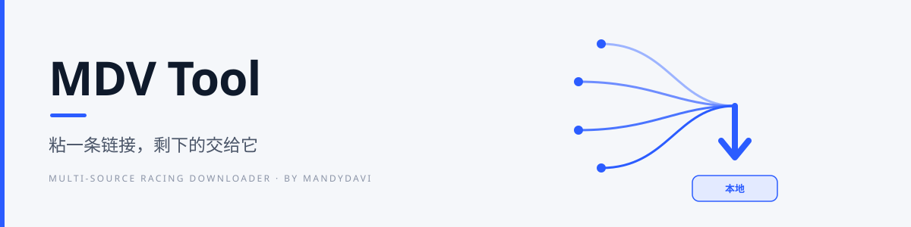
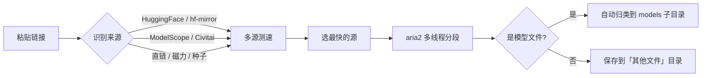

<picture>
  <source media="(prefers-color-scheme: dark)" srcset="docs/hero-dark.svg">
  
</picture>

<p align="center">
  <b>v1.0.0</b> &nbsp;·&nbsp; Windows 10 / 11 (64-bit) &nbsp;·&nbsp; MIT &nbsp;·&nbsp; .NET 10
  <br>
  <a href="../../releases/latest">下载</a> &nbsp;·&nbsp;
  <a href="../../issues">反馈</a> &nbsp;·&nbsp;
  <a href="../../actions">构建状态</a>
</p>

> **粘一条链接，剩下的交给它。**
> 软件、压缩包、镜像、视频都能下；如果下的是模型，它会自动认出来，放进 ComfyUI 对应的 `models` 子目录。

**MDV** 取自作者名字 **Mandydavi** 的缩写。这不是又一个下载器皮肤——它把「找最快的源」和「放到对的目录」这两件最烦的事，一起做掉了。

---

## 三秒上手

| | |
|:--:|---|
| **1** | 从 [Releases](../../releases/latest) 拿 `MDVTool-1.0.0.exe`，双击，不用安装 |
| **2** | 把链接粘进输入框，或直接把 `.torrent` 拖进来 |
| **3** | 点「开始下载」。测速、选源、归类，它自己完成 |

程序目录里没有 `aria2c.exe` 时，启动时会自动提示获取下载引擎（约 1.8 MB 压缩包）。

## 里面发生了什么



## 它凭什么快

<table>
  <tr>
    <td width="50%" valign="top"><b>四源竞速</b><br>HuggingFace、hf-mirror、ModelScope、Civitai 同时测速，谁快用谁。一个源挂了不影响下载。</td>
    <td width="50%" valign="top"><b>多线程分段</b><br>aria2 引擎，按站点实测择优选择连接数，最高 32 连接，把带宽吃满。</td>
  </tr>
  <tr>
    <td valign="top"><b>断点续传</b><br>中断后从断点继续，不重下。下 11 GB 的模型也不怕断网。</td>
    <td valign="top"><b>自动归类</b><br>按扩展名认出模型，落到 <code>loras</code> / <code>vae</code> / <code>diffusion_models</code> 等对应目录。</td>
  </tr>
</table>

## 它能下什么

**通用下载** —— 默认走「其他文件」目录，任何站点都不需要预先支持

- HTTP / HTTPS 直链：软件安装包、ZIP / 7z / RAR、ISO 镜像、视频、字体……
- 磁力链接与 `.torrent` 种子

**模型下载** —— 自动归到 ComfyUI 目录

- HuggingFace、hf-mirror、ModelScope、Civitai
- 按类型落到 `diffusion_models` / `loras` / `vae` / `text_encoders` / `controlnet` / `upscale_models` / `embeddings`
- 粘仓库地址会先列出文件清单让你挑，不用自己拼下载链接

## 全部功能

- **并发上限**：同时下几个由你定，其余自动排队
- **全局限速**：限制总带宽，不影响家里人看视频
- **代理**：HTTP / SOCKS5，只对下载引擎生效，不改系统设置
- **同名文件策略**：询问 / 覆盖 / 跳过 / 重命名
- **磁盘空间预检**：空间不够提前拦下，不会下到 99% 才失败
- **托盘常驻**：下载完成弹通知，不占任务栏
- **关闭行为三选一**：收进托盘继续下载 / 每次询问 / 直接退出
- **自动更新**：启动后静默检查，有新版在状态条提示
- **深色主题**、历史按天分组、统一的界面内弹窗

## 下载

到 [Releases](../../releases/latest) 取最新版，两种：

| 方式 | 文件 | 适合 |
|---|---|---|
| **单文件版** | `MDVTool-x.y.z.exe` | 双击即用，不用安装，也不需要 .NET 运行时 |
| **绿色版** | `MDVTool-x.y.z.zip` | 内含 exe、README、LICENSE，解压即用，放 U 盘也能跑 |

两个包里的程序完全一样，ZIP 只是多带了说明文件。**目前没有安装版**：不写注册表、不建开始菜单项，不想用了直接删文件即可。

> **仅支持 Windows 10 / 11（64 位）**，不需要安装 .NET 运行时。
> macOS 和 Linux 目前**不支持**——界面是 C# / WPF 写的，WPF 只有 Windows 有，移植等于重写整个界面层，短期不会做。

## 它不做什么

把边界写清楚，比多写十个功能更重要：

- 不解析他人的网盘分享链接，不绕过任何限速或会员机制
- 不内置、不分发任何模型文件，只提供下载能力
- 不上传你的下载记录、文件内容或任何使用数据
- 没有付费版、没有功能限制、没有每日次数

## 赞助

软件免费、源码全开，打赏全凭自愿，不影响任何功能。

<table>
  <tr>
    <td align="center"><b>微信支付</b></td>
    <td align="center"><b>支付宝</b></td>
  </tr>
  <tr>
    <td></td>
    <td></td>
  </tr>
</table>

> 打赏不换取任何特权，也不影响 issue 的处理顺序。

<details>
<summary><b>给开发者：构建、目录、更新机制</b></summary>

### 从源码构建

需要 [.NET 10 SDK](https://dotnet.microsoft.com/download)：

```
dotnet publish MDVTool.Desktop/MDVTool.csproj -c Release -r win-x64 ^
  --self-contained true -p:PublishSingleFile=true -p:EnableCompressionInSingleFile=true -o out
```

### 目录结构

| 路径 | 内容 |
|---|---|
| `MDVTool.Desktop/` | 主程序（WPF） |
| `MDVTool.Desktop/Sources/` | 下载源适配器。新增站点只需实现 `IModelSource` 并在注册表加一行 |
| `version.json` | 更新检查用的版本元数据 |
| `.github/workflows/release.yml` | 打 tag 自动构建发版 |

### 更新机制

客户端启动 10 秒后检查更新：先读仓库的 `releases.atom` 拿到最新 tag，再取该 tag 下的 `version.json`；版本更高就在状态条显示提示，点击跳到 Release 页面。

用 tag 地址而不是分支地址，是为了绕开 jsDelivr 对 `@main` 最长 12 小时的缓存。取不到时会自动回退到 jsDelivr 分支地址、raw.githubusercontent 和 gcore 镜像——国内直连 GitHub raw 基本不通。

### 发版

```
git tag v1.0.1 && git push origin v1.0.1
```

GitHub Actions 会编译、重命名成 `MDVTool-1.0.1.exe` / `.zip`、算 SHA-256 并建 Release。

</details>

## 致谢与许可

本程序自身代码以 [MIT](LICENSE) 许可发布。

发布包**不含** [aria2](https://aria2.github.io/)。程序发现缺少 `aria2c.exe` 时会引导你从其官方发布页获取；aria2 以 GPLv2 许可分发，本项目未对它做任何修改，也不随包分发。
